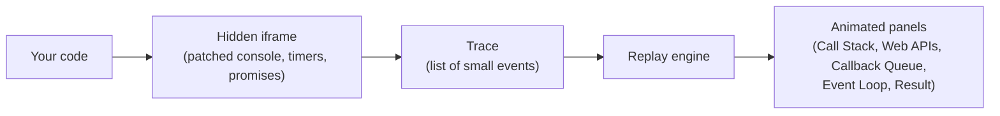

# Loopscope: JavaScript Event Loop Visualizer

The event loop is easy to read about and hard to picture. Loopscope lets you watch it happen.

Paste any JavaScript snippet, press **Start**, and see it travel through the **Call Stack**, **Web APIs**, **Callback Queue** and the **Event Loop**, with the console output appearing in the **Result** panel. There is no login, no backend and no build step. Open the page and use it.


- **Live demo:** [Open Loopscope](https://its-lnv.github.io/loopscope/)
- **Repository:** [github.com/its-lnv/REPLACE-WITH-REPO-NAME](https://github.com/its-lnv/loopscope)


---

## Why Loopscope?

Some event loop demos animate a fixed example. Loopscope runs the snippet you paste, records what happens, and replays it, so you can test the exact code that confuses you.

---

## Features

- **Paste and run:** write your own JavaScript or load one of four built-in examples (timers and promises, async/await, nested timers, setInterval).
- **Two ways to run:**
  - **Start:** every step plays automatically, and the Result fills in as it goes. Press **Pause** to stop at any point.
  - **Next step:** you move the process forward one action at a time.
- **Adjustable pace:** two sliders control how fast it feels.
  - *Animation speed* changes how quickly chips fly between panels.
  - *Delay between steps* (0 to 4 seconds) sets the pause between actions in auto mode.
- **Sync vs async check:** each built-in call (such as `console.log` or `setTimeout`) is shown entering the call stack and being checked. Sync calls run immediately and print to Result. Async calls are handed to the Web APIs.
- **Animated timers:** a timer in the Web APIs panel shows a progress bar for its delay. When it finishes, the callback moves to the Callback Queue.
- **Event loop in action:** when the call stack is empty, the event loop picks the next waiting job and moves it onto the stack, where it runs and prints its result.
- **Realistic ordering:** promise jobs run before timer callbacks, the same as in a real browser.
- **Responsive:** works on desktop and phone screens.

---

## Try it: can you predict the output?

Paste this into Loopscope before you press Start:

```js
console.log('start');

setTimeout(() => console.log('timeout'), 0);

Promise.resolve().then(() => console.log('promise'));

console.log('end');
```

<details>
<summary>Show the answer</summary>

```
start
end
promise
timeout
```

`start` and `end` are synchronous, so they run first. The promise callback is a microtask, and the event loop runs microtasks before it takes the next timer callback, even when the timer delay is 0. Loopscope shows both kinds of job in the same Callback Queue panel, but runs them in the real order. Press **Next step** to watch each hand-off.

</details>

---

## How it works

Loopscope uses a **record, then replay** design.



### 1. Record: run the code for real

When you press Start or Next step, your code is executed once inside a hidden, same-origin `<iframe>` (`srcdoc`). Inside that iframe, the page replaces a few globals with instrumented versions that write to an event list (the trace):

| Patched API | What it records |
|---|---|
| `console.log / info / warn / error` | Frame pushed, "sync" check, output line, frame popped |
| `setTimeout`, `setInterval` | Frame pushed, "async" check, timer added to Web APIs, frame popped |
| `clearTimeout`, `clearInterval` | Timer removed from Web APIs |
| `Promise.prototype.then` (and so `catch` / `finally`) | Promise job added to the queue, taken by the event loop, run on the stack |
| `queueMicrotask` | Same as a promise job |
| Function declarations | `main()` and each named, non-async function show up as call stack frames |

Because your code really runs, the values and the order of the console output come from actual execution, not from a script written in advance. Two parts are modelled rather than observed: timers (they run on a virtual clock, below) and `await` continuations (below).

**Virtual clock for timers.** Timers do not use real waiting. After the main script and all promise jobs finish, the recorder takes the timer with the earliest due time, advances a virtual clock to it, runs its callback, and repeats. A 5 second timeout is therefore recorded instantly and only *animated* later.

**Function frames.** Named, non-async `function` declarations are wrapped with a small source transform (`try { ... } finally { ... }`) so their calls and returns appear on the call stack.

**Await continuations.** Code that resumes after an `await` is shown as an "await continuation" job, since JavaScript does not let a page observe these directly.

### 2. Replay: animate the trace

The trace is a list of small events such as `push`, `pop`, `check`, `log`, `web`, `fire`, `micro`, `take`, `webdel` and `end`. The replay engine walks through them one at a time:

- `exec(event)` updates the DOM and waits for its animation to finish.
- **Start** loops over the events, pausing for the chosen delay between each one.
- **Next step** executes exactly one event per click.
- Chips travel between panels with the **Web Animations API**: a clone of the chip is created at the source position and animated to the destination, then replaced by the real element.
- Timer progress bars are animated for a duration based on the timer's delay. The event loop waits for the bar to finish before moving the callback onward.

---

## Tech stack

- **HTML5**
- **CSS3**: Grid, Flexbox, custom properties, keyframe animations, responsive media queries
- **Vanilla JavaScript (ES2020)**: no frameworks, libraries or build tools
- **Web Animations API** for chips moving between panels
- **Google Fonts**: Fraunces (headings), Inter (interface), JetBrains Mono (code)

The entire app is one `index.html` file (HTML, CSS and JS together).

---

## Project structure

```
loopscope/
├── index.html      # the whole app (HTML, CSS and JS)
├── assets/
│   └── demo.gif    # demo shown at the top of this README
├── LICENSE
└── README.md
```

---

## Run locally

1. Download or clone the repository.
2. Open `index.html` in any modern browser (Chrome, Edge, Firefox, Safari).

No install step and no server required.

## Deploy

Any static host works. For example, with **GitHub Pages**: push the repo, then go to *Settings > Pages* and choose the `main` branch and the root folder. Netlify and Vercel also work by dragging in the folder.

---

## Design

- **Theme:** minimal creamy-light background with green highlights.
- **Colors:** cream (`#faf6ec`), card white (`#fffdf7`), green (`#2f7d4f`) and amber (`#b9801a`) for timers.
- **Type:** large, readable text throughout, with a serif for headings and monospace for code and chips.
- Chips are color-coded: green for call stack frames, amber for timers, teal for promise jobs.

---

## Notes and limitations

- Frames for `async function` calls are not drawn on the call stack, though their code and `await` continuations are shown.
- `setInterval` is stopped after 5 runs in the demo, so it cannot run forever.
- The recording stops after about 600 steps to protect against infinite loops and runaway recursion.
- Promise jobs appear in the queue at the moment they run, not at the moment `.then()` is called.
- Only core timing APIs are supported. `fetch`, DOM events and Node-only APIs such as `process.nextTick` are not.
- Promise jobs and timer callbacks share one visual queue. The ordering follows the real rules, but there is no separate microtask panel.
- Only the APIs in the table above are instrumented. Timers run on a virtual clock, so code that measures real elapsed time (for example with `Date.now()`) will not see the timer delays.
- Your snippet runs in a hidden same-origin iframe, which is not a security sandbox. Only run code you trust. Your code is not uploaded anywhere, because there is no backend.

---

## Roadmap

- [ ] Separate microtask queue view (optional toggle)
- [ ] Call stack frames for async functions
- [ ] Support for `fetch` and DOM events
- [ ] Highlight the currently executing line in the editor
- [ ] Save and share snippets through a link

---

## Contributing

Issues and pull requests are welcome. If a snippet shows the wrong order or breaks the recorder, open an issue with the snippet and the output you expected.

---

## Credits

Inspired by the idea behind [nodeloops.com](https://nodeloops.com) and by Philip Roberts' talk "What the heck is the event loop anyway?".

## License

This project is licensed under the MIT License.
See the [LICENSE](LICENSE) file for details.

## Author

Built by [Laxmi Narayan Verma](https://www.linkedin.com/in/its-lnv/) ([GitHub](https://github.com/its-lnv)).
